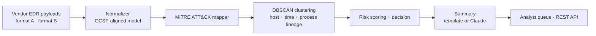

# SOC AI Alert Triage Pipeline

[](https://github.com/dawncreter/soc-ai-alert-triage-pipeline/actions/workflows/ci.yml)

This pipeline turns a flood of endpoint (EDR) alerts into a short, ranked queue of incidents for a security operations center (SOC). It normalizes alerts from different vendors into one schema, maps activity to **MITRE ATT&CK**, groups related alerts into incidents, scores risk, and writes an analyst-ready summary.

> **Reference implementation** built on synthetic data. It reflects the triage problems I worked on as Interim Head of Product at Binary Defense (MDR / Open XDR) and as Head of Intelligence at Cofense (see the [ML threat remediation case study](https://github.com/dawncreter/ml-threat-remediation-case-study)). It is not either company's code.

## The problem
Tier-1 analysts drown in repetitive, low-value alerts while multi-stage attacks hide in the noise. The goal is to show analysts **incidents, not alerts**, ranked by how far an attacker has progressed.

## Architecture


| Stage | File | Notes |
|---|---|---|
| Normalize | `normalizer.py` | Two vendor formats → one `SecurityAlert` model (pydantic v2); malformed payloads are reported, not fatal |
| Enrich | `mitre.py` | Readable rule table for PowerShell, LSASS dumping, certutil downloads, scheduled tasks, PsExec and more |
| Cluster | `clustering.py` | DBSCAN with a custom distance (below) |
| Triage | `triage.py` | Risk score, verdict, action (contain / escalate / monitor / suppress) and summary |
| Serve | `api.py` | FastAPI: `POST /triage` returns the prioritized queue |

**Alert distance:** 1.0 across different hosts. On the same host it is `min(1, Δt / 30 min)`, halved when two alerts share process lineage. Alerts within `eps = 0.25` chain into one incident.

**Risk score (0–100):** `raw = 2·max_severity + Σ tactic_weight + 2·(distinct_tactics − 1) + log2(distinct_processes)`, then `risk = 100·(1 − e^(−raw/12))`. Credential access, lateral movement and impact weigh most, and a long kill chain beats a loud single alert.

## Demo
```text
$ soc-triage demo --hosts 200
[INC-0210] risk 99.1 contain  eng-wks-22: 7 alert(s) over 15 min. Kill chain: Initial Access → Execution →
           Persistence → Defense Evasion → Discovery → Credential Access → Lateral Movement → Command and Control …
[INC-0686] risk 99.1 contain  fin-wks-07: …

alerts_in 1214 · incidents 1096 · analyst_queue 2 · suppressed 868 · precision 1.0 · recall 1.0
```
These numbers come from clean synthetic data. Real telemetry is noisier, so the scoring weights are meant to be tuned against labelled history.

## Quick start
```bash
pip install -e ".[dev]"
soc-triage demo
uvicorn soctriage.api:app --reload      # then POST alerts to /triage
make test                               # 18 tests, ~99% branch coverage
```
Optional: set `ANTHROPIC_API_KEY` and use `ClaudeSummarizer` for richer investigation notes.

## Related results from my career
* **Cofense:** ML remediation at 99.998% accuracy and 66% fewer false-positive alerts
* **Syniverse:** incident command for 92 products at 99.999% availability

## License
MIT
